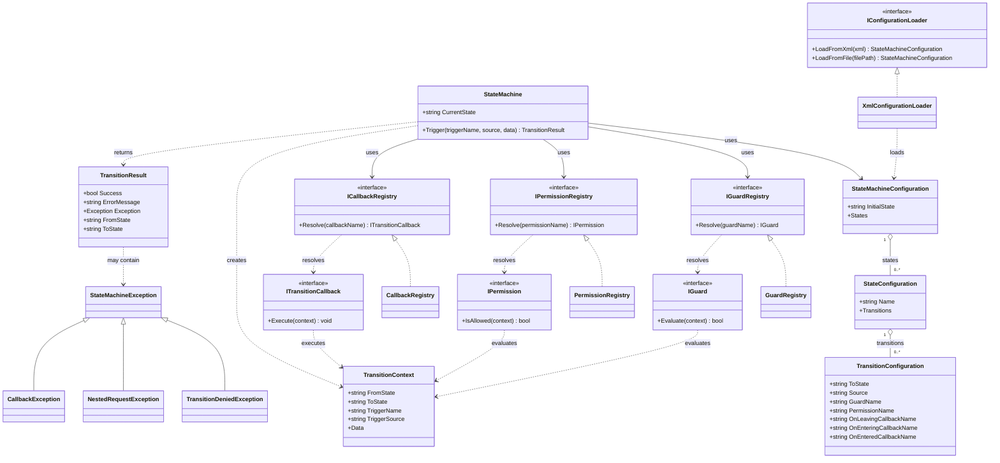
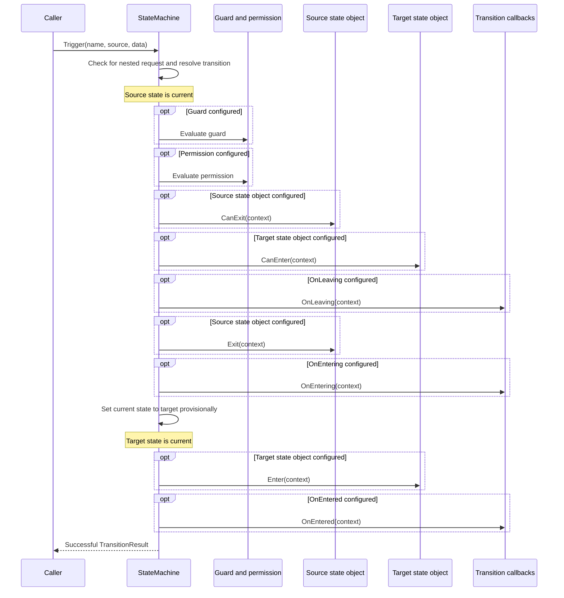

# AvakStateMachine Framework

## Overview

**AvakStateMachine** is a reusable, generic .NET state machine framework that provides a clean, declarative way to manage state transitions in applications. State machines are configured via XML, validated at startup, and executed with full support for guards, permissions, and lifecycle callbacks.

The framework emphasizes **safety and explicitness**: transitions fail cleanly when guards/permissions deny them or when callbacks throw exceptions, with automatic rollback to preserve machine integrity.

## Key Features

### 1. XML-Based Configuration
- State machines are defined in XML and validated before runtime
- DTDs and external entity resolution are prohibited for security
- Clear, readable declarative syntax for state and transition definitions

### 2. Source-Aware Triggers
- Transitions are resolved by:
  - Current state
  - Trigger name
  - Trigger source (optional, e.g., "UI", "API", etc.)
- Multiple transitions can exist for the same (state, trigger) pair if they differ by source
- Fallback to source-agnostic transitions when source-specific ones don't match

### 3. Extension Points
The framework provides three types of extension points, all injected via registries:

#### Guards
- Evaluate conditions before a transition begins
- If a guard returns `false`, the transition is denied immediately
- State machine remains unchanged; no callbacks are executed

#### Permissions
- Evaluate authorization/policy before a transition begins
- Similar to guards but semantically represent "does the caller have permission?"
- If a permission returns `false`, the transition is denied

#### Resolving configured names
Guard, permission, and callback names are optional, but every non-null name in the
configuration must resolve through its corresponding registry when the
`StateMachine` is constructed. Register implementations before construction.
An unresolved name throws `UnresolvedExtensionException` with the extension
type, name, state, and trigger; a present but blank name is invalid. If no
registry is supplied, the framework uses an empty registry, so construction
succeeds only when the configuration does not reference names in that registry.

Registries are consulted again when a transition runs. If a custom registry
later stops resolving a previously registered name, the transition fails
explicitly; missing guards and permissions never allow a transition, and
missing callbacks are never silently skipped.

#### Lifecycle Callbacks
Callbacks are named on individual transitions. With named-only states, they run
in this order:

1. **OnLeaving**: work associated with leaving the source state, such as releasing resources.
2. **OnEntering**: work associated with preparing the target state, such as initializing resources.
3. The machine changes `CurrentState` to the target state.
4. **OnEntered**: work associated with having entered the target state, such as notifying observers.

Both `OnLeaving` and `OnEntering` run while the source state is current; they
separate responsibilities rather than observe different current states.
`OnEntered` runs while the target state is current, but the transition is
provisional until the callback returns successfully. There is currently no
`OnLeft` callback.

If a callback throws, the transition fails and the machine restores its internal
source state. External side effects from callbacks are not automatically undone;
avoid irreversible work or provide application-level compensation.

A request made while the same machine is processing another request is rejected
with a failed result containing `NestedRequestException`. The outer transition
also fails and restores its source state even if the nested result is ignored or
its exception is caught. This applies to guards, permissions, and callbacks.
No later transition stages run after the nested attempt is detected. If a
callback itself throws, its failure is reported as a `CallbackException`.

### 4. Explicit Failure Handling
Each transition returns a `TransitionResult` containing:
- `Success`: Boolean indicating whether the transition succeeded
- `ErrorMessage`: Detailed error message (if failed)
- `Exception`: The underlying exception (if applicable)
- `FromState` and `ToState`: Source and target states

Failure modes include:
- **Guard denied**: Guard returned `false`
- **Permission denied**: Permission returned `false`
- **Callback threw**: Lifecycle callback raised an exception
- **Nested request**: A trigger was attempted while another transition was in progress
- **Invalid trigger**: No transition exists for the given (state, trigger, source) combination

### 5. Automatic Rollback
When a transition fails:
- The machine's internal `CurrentState` is restored to the source state
- No callbacks are executed after the failure point
- External side effects performed by earlier callbacks are NOT automatically undone

### 6. Single-Threaded, Synchronous Design
- The framework is designed for single-threaded, synchronous use
- Nested requests (triggers fired while another request is processing) are rejected
- No concurrency guarantees in this version

## Architecture

### Core class diagram

The diagram shows the core types and their principal relationships. Names on
transitions are string references, not direct links to state or extension objects.



In the debugger, the configuration, transition context, result, and machine
types show their key values. The state configuration's transition count is the
total number of transitions across all trigger groups. A transition
configuration displays its target and each optional property that is not null.

### State Representation

Each XML `<State name="...">` defines a named state, and the machine exposes
its current state as a string. A state may optionally specify `stateClass` to
associate it with an application-supplied object derived from `State`. Both
representations use the same transition engine and can be mixed in one machine.
Existing named-only configurations require no state objects.

`State` provides virtual `CanEnter` and `CanExit` methods that default to
`true`, and `Enter` and `Exit` methods that default to no-ops. Override only
the behavior needed. State checks are intended for state-specific rules;
transition guards and permissions remain appropriate for transition-specific
conditions and authorization. This distinction is guidance, not a security
boundary enforced by the framework.

```xml
<State name="InReview" stateClass="ReviewState">
  <Transitions>
    <Transition trigger="Approve" to="Approved" />
  </Transitions>
</State>
```

```csharp
using Avak.StateMachine.Core;
using Avak.StateMachine.Core.Extensions;

public sealed class ReviewState : State
{
    public override bool CanEnter(StateContext context) => true;
    public override void Enter(StateContext context) { /* application behavior */ }
}

var states = new StateRegistry();
states.Register("ReviewState", new ReviewState());
var machine = new StateMachine(configuration, null, null, null, null, states);
```

The six-argument constructor accepts guard, permission, and callback registries,
an optional logger, and the state registry in that order. Pass the application's
registries in place of `null` when the XML names those extensions. The original
constructor remains available; it uses an empty state registry and therefore
rejects configurations that reference a state class.

The XML value is a registry key, not a CLR type name: no reflection or dynamic
type loading is performed. Every configured key must be nonblank and resolve
before initial entry, otherwise construction fails explicitly. The machine
resolves and retains each configured object at construction; later registry
changes do not replace it. The application owns the objects and their lifetime:
the framework does not create or dispose them. Use separate instances per
machine when state objects hold mutable data. Do not mutate the configuration
after construction.

For a class-backed initial state, construction calls `CanEnter` and then
`Enter`. A denied check throws `TransitionDeniedException`; a method exception
throws `StateExecutionException` with the original exception as its inner
exception. No usable machine is returned on failure, and transition callbacks
do not run for initialization. Initial entry can produce external side effects
even if construction later fails; they are not automatically undone.

State methods receive a `StateContext`: `FromState`, `ToState`, `TriggerName`,
`TriggerSource`, `Data`, and `IsInitialization`. During initialization,
`FromState`, `TriggerName`, and `TriggerSource` are null, `ToState` is the
initial state, and `Data` starts empty. For a trigger, context values describe
the transition and `Data` is the same dictionary supplied to transition
callbacks. Self-transitions invoke both source and target methods, subject to
earlier checks and methods succeeding. See [Transition Execution Flow](#transition-execution-flow)
for ordering and failure behavior.

This feature is newer than the published `0.1.0-preview.1` package; use a
project reference until a package containing it is released.

### Core Components

#### `StateMachineConfiguration`
The parsed representation of an XML state machine definition. Contains:
- `InitialState`: The starting state
- `States`: Dictionary of state definitions

#### `StateConfiguration`
Represents a single state and its transitions:
- `Name`: The state's name
- `StateClassName`: Optional registry key for a state object
- `Transitions`: Dictionary of trigger name → list of `TransitionConfiguration` objects

#### `TransitionConfiguration`
Represents a single transition rule:
- `ToState`: Target state (required)
- `Source`: Trigger source filter (optional; `null` means "any source")
- `GuardName`: Guard logic name (optional)
- `PermissionName`: Permission logic name (optional)
- `OnLeavingCallbackName`: Callback to execute before leaving (optional)
- `OnEnteringCallbackName`: Callback to execute before entering (optional)
- `OnEnteredCallbackName`: Callback to execute after entering (optional)

The XML `trigger` attribute is stored as the key in the containing state's
`Transitions` dictionary, not as a property of `TransitionConfiguration`. For
example, a transition with `trigger="Start"` is added to
`state.Transitions["Start"]`. The machine first looks up that trigger in the
current state, then selects a transition from the resulting list by source.

Consequently, a `TransitionConfiguration` inspected on its own does not reveal
its trigger name; inspect its containing dictionary entry to find it. Keeping
the name only as the key avoids duplicating it in each transition and needing
to keep the two values consistent.

#### `StateMachine`
The runtime engine:
```csharp
public class StateMachine
{
    public string CurrentState { get; }
    public TransitionResult Trigger(string triggerName, string? source = null, 
        IDictionary<string, object?>? data = null);
}
```

#### `TransitionResult`
Returned from each `Trigger()` call:
```csharp
public class TransitionResult
{
    public bool Success { get; set; }
    public string? ErrorMessage { get; set; }
    public Exception? Exception { get; set; }
    public string FromState { get; set; }
    public string ToState { get; set; }
}
```

#### `TransitionContext`
Passed to all guards, permissions, and callbacks:
```csharp
public class TransitionContext
{
    public string FromState { get; set; }
    public string ToState { get; set; }
    public string TriggerName { get; set; }
    public string? TriggerSource { get; set; }
    public IDictionary<string, object?> Data { get; set; }
}
```

### Extension Point Interfaces

#### `IGuard`
```csharp
public interface IGuard
{
    bool Evaluate(TransitionContext context);
}
```

#### `IPermission`
```csharp
public interface IPermission
{
    bool IsAllowed(TransitionContext context);
}
```

#### `ITransitionCallback`
```csharp
public interface ITransitionCallback
{
    void Execute(TransitionContext context);
}
```

### Registry Interfaces

- `IGuardRegistry`: Maps guard names to `IGuard` implementations
- `IPermissionRegistry`: Maps permission names to `IPermission` implementations
- `ICallbackRegistry`: Maps callback names to `ITransitionCallback` implementations

## Optional Logging

The source API accepts an optional `ILogger<StateMachine>` constructor argument:

```csharp
var machine = new StateMachine(configuration, logger: logger);
```

Omitting the logger uses a no-op logger. The core references
`Microsoft.Extensions.Logging.Abstractions`, not a logging provider or DI
container. Applications choose and configure their providers. When using .NET
DI, registering logging makes `ILogger<StateMachine>` available for constructor
injection; logging is not required to resolve the machine.

The machine emits outcome records for completed trigger requests and one
separate record when a nested trigger is first attempted:

| Event ID | Name | Level | Outcome |
| --- | --- | --- | --- |
| 100 | `TransitionSucceeded` | Information | Transition completed successfully |
| 101 | `TransitionRejected` | Debug | No matching transition, or guard/permission denial |
| 102 | `NestedRequestDetected` | Warning | A nested trigger was rejected when first attempted |
| 103 | `TransitionFailed` | Error | Callback failure or another returned transition error |

Outcome records use `TriggerName`, `FromState`, `ToState`, `TriggerSource`, and
`Success`. `ToState` describes the resulting state, not the attempted target:
on failure it is the restored source state. Event 102 instead records the
nested attempt with `TriggerName`, `TriggerSource`, and `CurrentState` (the
state at the time the nested request was made). Only the first nested attempt
is logged; when the outer result is a nested-request failure, it does not emit
a duplicate outcome record.

Logs supplement, rather than replace, `TransitionResult` and explicit exception
handling. Exceptions returned in a failure result are attached to the record.
Guards and permissions that throw are still classified as denials under the
existing runtime contract.

Request data is not automatically logged. Attached exceptions can contain
user-supplied messages or inner exceptions; configure access and redaction
appropriately, and avoid putting secrets in names or exception messages.

Custom loggers must not trigger the machine recursively. If a logger throws,
the exception propagates, the machine restores its internal source state, and
the request-processing flag is cleared. Already executed callbacks or emitted
logs cannot be undone. Construction/validation exceptions and exceptions
that escape trigger processing are surfaced directly, not automatically logged.

This feature is newer than the published `0.1.0-preview.1` package; use a project
reference until a package containing it is released.

Default implementations (`GuardRegistry`, `PermissionRegistry`, `CallbackRegistry`) are provided for simple in-memory registration.

## XML Configuration Format

### Basic Structure
```xml
<?xml version="1.0" encoding="utf-8"?>
<StateMachine initialState="InitialStateName">
  <States>
    <State name="StateName1">
      <Transitions>
        <Transition trigger="TriggerName" to="StateName2" />
      </Transitions>
    </State>
    <State name="StateName2" />
  </States>
</StateMachine>
```

### Transition with Guards, Permissions, and Callbacks
```xml
<Transition 
  trigger="TriggerName" 
  source="SourceIdentifier"
  to="TargetState" 
  guard="GuardLogicName"
  permission="PermissionLogicName"
  onLeaving="OnLeavingCallbackName"
  onEntering="OnEnteringCallbackName"
  onEntered="OnEnteredCallbackName" />
```

### Attributes

| Attribute | Required | Type | Description |
|-----------|----------|------|-------------|
| `initialState` | Yes (on `StateMachine`) | String | Name of the starting state |
| `name` | Yes (on `State`) | String | Unique state name |
| `stateClass` | No (on `State`) | String | Registry key for an optional state object |
| `trigger` | Yes (on `Transition`) | String | Trigger identifier |
| `to` | Yes (on `Transition`) | String | Target state name |
| `source` | No | String | Trigger source filter |
| `guard` | No | String | Guard logic name |
| `permission` | No | String | Permission logic name |
| `onLeaving` | No | String | Callback name for leaving |
| `onEntering` | No | String | Callback name for entering |
| `onEntered` | No | String | Callback name for post-entry |

### Validation Rules

1. `initialState` must be nonblank and reference an existing state.
2. State names, trigger names, and target state names must be nonblank; each
   target must reference an existing state.
3. State names must be unique. For each state and trigger, each source may
   occur only once. An omitted or empty source represents the same
   source-agnostic transition.
4. Configured state-class, guard, permission, and callback names must be nonblank.
   State-class keys must resolve during machine construction.
5. Unknown elements, attributes, non-whitespace text, duplicate `States` or
   `Transitions` containers, and XML namespaces are rejected.
6. DTDs and external entity resolution are prohibited.

## Transition Execution Flow

When `machine.Trigger("TriggerName", "SourceValue", data)` is called:

1. **Nested Request Check**: If the machine is already processing a transition, return failure with `NestedRequestException`; the outer request also fails and restores its source state
2. **Trigger Resolution**: Look up transitions in `CurrentState` for matching trigger name
3. **Transition Selection**: 
   - Prefer source-specific transitions if a matching source exists
   - Fall back to source-agnostic transitions (where `source` is `null`)
   - If no match found, return failure
4. **Guard Evaluation**: If guard exists, invoke it
   - If guard returns `false`, return failure with `TransitionDeniedException`
   - If guard throws, return failure with the exception
5. **Permission Evaluation**: If permission exists, invoke it
   - If permission returns `false`, return failure with `TransitionDeniedException`
   - If permission throws, return failure with the exception
6. **State checks**: Call the source object's `CanExit`, then the target
   object's `CanEnter`, when configured. A `false` result returns a
   `TransitionDeniedException`; an exception returns `StateExecutionException`
   with the original exception as its inner exception.
7. **Leaving**: Invoke `OnLeaving`, then source `Exit`, while the source is current.
8. **Entering**: Invoke `OnEntering`, while the source is still current.
9. **Transition**: Update `CurrentState` to the target provisionally.
10. **Entry**: Invoke target `Enter`, then `OnEntered`, while the target is current.
11. **Success**: Return `TransitionResult` with `Success = true`.

The following diagram shows the successful path. Optional stages run only when
their guard, permission, callback, or state object is configured.



An unmatched trigger, denial, exception, or nested request stops the successful
path. For a failed transition, the machine restores its internal source state
and returns a failure result; external side effects are not undone. Exceptions
that escape trigger processing, such as a throwing logger, propagate instead.

Each stage runs only if earlier stages succeeded. On a state method or callback
exception, the machine restores its internal source state and returns a failed
result. A nested request inside a state method is rejected and causes the outer
request to fail even if ignored or caught. If that method also throws, its
failure is reported as `StateExecutionException`.

## Rollback Behavior

When a transition fails at any point:
- The machine's `CurrentState` is restored to the state before the transition attempt
- Callbacks already executed (before the failure) are **not** rolled back
- Changes to state objects made by lifecycle methods are **not** rolled back
- External side effects (file writes, API calls, etc.) performed by callbacks are **not** automatically undone

### Recommendation for Callbacks with Side Effects
Applications should either:
1. Avoid irreversible work in callbacks, or
2. Implement compensation logic within callbacks (e.g., try/catch with explicit undo)

Example:
```csharp
public class WriteLogCallback : ITransitionCallback
{
    public void Execute(TransitionContext context)
    {
        // Good: Append-only operation, safe to leave partial
        File.AppendAllText("log.txt", $"{context.TriggerName} at {DateTime.Now}\n");
    }
}

public class RiskyUpdateCallback : ITransitionCallback
{
    private string? _originalValue;
    
    public void Execute(TransitionContext context)
    {
        // Less safe: Modifying external state without compensation
        // If a later callback throws, this update persists
        _originalValue = Database.GetValue("key");
        Database.SetValue("key", "new_value");
        // Better: Provide compensation if needed
    }
}
```

## Usage Example

### 1. Define Configuration (XML)
```xml
<?xml version="1.0" encoding="utf-8"?>
<StateMachine initialState="Stopped">
  <States>
    <State name="Stopped">
      <Transitions>
        <Transition trigger="Start" to="Running" onLeaving="PrepareStart" onEntered="OnStarted" />
      </Transitions>
    </State>
    <State name="Running">
      <Transitions>
        <Transition trigger="Stop" to="Stopped" onLeaving="Cleanup" />
      </Transitions>
    </State>
  </States>
</StateMachine>
```

### 2. Implement Guards/Permissions/Callbacks (C#)
```csharp
public class CanStartGuard : IGuard
{
    private readonly ISystemStatus _status;
    
    public CanStartGuard(ISystemStatus status) => _status = status;
    
    public bool Evaluate(TransitionContext context)
    {
        return _status.IsHealthy;
    }
}

public class PrepareStartCallback : ITransitionCallback
{
    private readonly ILogger _logger;
    
    public void Execute(TransitionContext context)
    {
        _logger.Info($"Preparing to start from {context.FromState}");
    }
}
```

### 3. Build and Use the State Machine
```csharp
var configLoader = new XmlConfigurationLoader();
var config = configLoader.LoadFromFile("machine-config.xml");

var guardRegistry = new GuardRegistry();
guardRegistry.Register("CanStart", new CanStartGuard(systemStatus));

var callbackRegistry = new CallbackRegistry();
callbackRegistry.Register("PrepareStart", new PrepareStartCallback(logger));

var machine = new StateMachine(config, guardRegistry: guardRegistry, 
    callbackRegistry: callbackRegistry);

var result = machine.Trigger("Start");
if (result.Success)
{
    Console.WriteLine($"Transitioned to {result.ToState}");
}
else
{
    Console.WriteLine($"Transition failed: {result.ErrorMessage}");
    if (result.Exception is TransitionDeniedException tde)
        Console.WriteLine($"Reason: {tde.Reason}");
}
```

## Exception Hierarchy

```
StateMachineException (base)
├── TransitionDeniedException (Guard or Permission denied)
├── NestedRequestException (Trigger during transition)
└── CallbackException (Callback threw exception)
```

## Scope and Limitations

### Current Version (Initial Release)
- **Single-threaded only**: No concurrent event processing
- **Flat states only**: No hierarchy or sub-states
- **Synchronous**: No async/await support
- **No hot reload**: Configuration changes require machine restart
- **No schema versioning**: XML format is fixed

### Future Considerations (Out of Scope for Now)
- Parallel states (orthogonal regions)
- Hierarchical states
- Async transitions and callbacks
- Configuration versioning
- Hot reloading
- Concurrent event processing with proper synchronization

## Testing Strategy

### Framework Tests (`Avak.StateMachine.Core.Tests`)
Located in `src/Framework/Avak.StateMachine.Core.Tests/`:
- XML parsing and validation
- Transition resolution (source-aware)
- Guard/permission evaluation
- Callback execution and error handling
- Nested request detection
- Rollback behavior
- Exception types and messages

**All tests are deterministic** and avoid external dependencies.

### Sample Tests (`ConsoleRecorder.Tests`)
Located in `src/Samples/200500_ConsoleRecorder/ConsoleRecorder.Tests/`:
- End-to-end recorder state machine scenarios
- Valid transitions and invalid trigger handling
- Multi-step workflows (Start → Pause → Resume → Stop)

Each sample includes:
- Sample project (e.g., `ConsoleRecorder`)
- Sample tests (e.g., `ConsoleRecorder.Tests`)
- Configuration XML file
- Guard/Permission/Callback implementations

## Building and Testing

### Framework Solution
```bash
cd src/Framework
dotnet build Avak.StateMachine.slnx -v minimal
dotnet test Avak.StateMachine.slnx --logger:console --verbosity normal
```

### Samples Solution
```bash
cd src/Samples
dotnet build Samples.slnx -v minimal
dotnet test Samples.slnx --logger:console --verbosity normal
```

## API Stability

The following are considered stable and ready for external use:
- All public types in `Avak.StateMachine.Core` namespace
- XML configuration format
- Exception hierarchy
- Extension point interfaces (`IGuard`, `IPermission`, `ITransitionCallback`)

Internal implementation details may change without notice.

## Security Considerations

1. **XML Parsing**: DTDs and external entity resolution are prohibited by default
2. **Validation**: All configuration is validated at load time
3. **No Code Execution**: State names, trigger names, and callback names are strings with no code injection; actual logic is supplied through typed interfaces
4. **Callback Isolation**: Callbacks execute in the caller's context; isolation requires application-level design

## Next Steps

Future enhancements may include:
1. Additional sample applications demonstrating different use cases
2. Performance optimizations for high-frequency triggers
3. Hierarchical states for complex workflows
4. Async/await support for long-running callbacks
5. Integration with popular DI containers
6. Enhanced diagnostics and tracing
