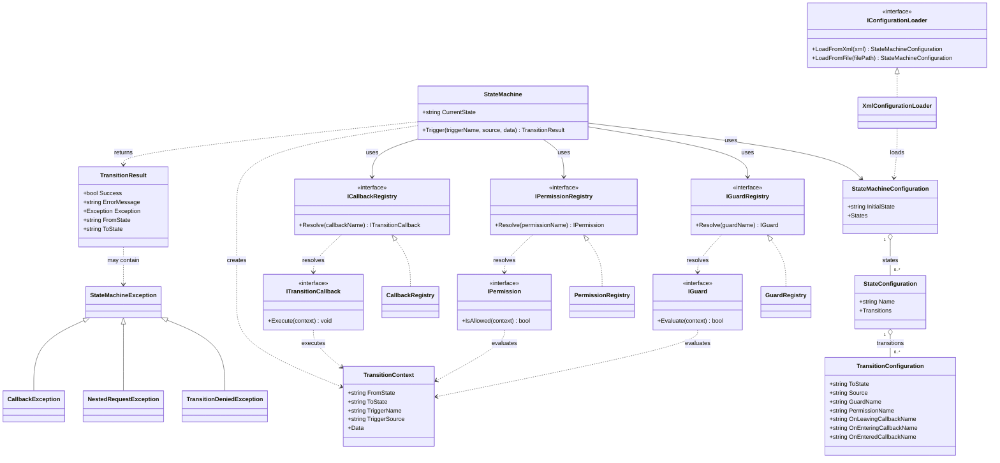

# AvakStateMachine Framework

## Overview

**AvakStateMachine** is a reusable, generic .NET state machine framework that provides a clean, declarative way to manage state transitions in applications. State machines are configured via XML, validated at startup, and executed with full support for guards, permissions, and lifecycle callbacks.

The framework emphasizes **safety and explicitness**: transitions fail cleanly when guards/permissions deny them or when callbacks throw exceptions, with automatic rollback to preserve machine integrity.

## Key Features

### 1. XML-Based Configuration
- State machines are defined in XML and validated before runtime
- DTDs and external entity resolution are prohibited for security
- Clear, readable declarative syntax for state and transition definitions

### 2. Source-Aware Triggers
- Transitions are resolved by:
  - Current state
  - Trigger name
  - Trigger source (optional, e.g., "UI", "API", etc.)
- Multiple transitions can exist for the same (state, trigger) pair if they differ by source
- Fallback to source-agnostic transitions when source-specific ones don't match

### 3. Extension Points
The framework provides three types of extension points, all injected via registries:

#### Guards
- Evaluate conditions before a transition begins
- If a guard returns `false`, the transition is denied immediately
- State machine remains unchanged; no callbacks are executed

#### Permissions
- Evaluate authorization/policy before a transition begins
- Similar to guards but semantically represent "does the caller have permission?"
- If a permission returns `false`, the transition is denied

#### Lifecycle Callbacks
Callbacks are named on individual transitions, not attached directly to states.
They run in this order:

1. **OnLeaving**: work associated with leaving the source state, such as releasing resources.
2. **OnEntering**: work associated with preparing the target state, such as initializing resources.
3. The machine changes `CurrentState` to the target state.
4. **OnEntered**: work associated with having entered the target state, such as notifying observers.

Both `OnLeaving` and `OnEntering` run while the source state is current; they
separate responsibilities rather than observe different current states.
`OnEntered` runs while the target state is current, but the transition is
provisional until the callback returns successfully. There is currently no
`OnLeft` callback.

If a callback throws, the transition fails and the machine restores its internal
source state. External side effects from callbacks are not automatically undone;
avoid irreversible work or provide application-level compensation.

The current implementation rejects a nested request by returning a failed
result. If the callback ignores that result, the outer transition can still
succeed. This is a known gap relative to the requirement that a nested request
must also fail the outer transition.

### 4. Explicit Failure Handling
Each transition returns a `TransitionResult` containing:
- `Success`: Boolean indicating whether the transition succeeded
- `ErrorMessage`: Detailed error message (if failed)
- `Exception`: The underlying exception (if applicable)
- `FromState` and `ToState`: Source and target states

Failure modes include:
- **Guard denied**: Guard returned `false`
- **Permission denied**: Permission returned `false`
- **Callback threw**: Lifecycle callback raised an exception
- **Nested request**: A trigger was attempted while another transition was in progress
- **Invalid trigger**: No transition exists for the given (state, trigger, source) combination

### 5. Automatic Rollback
When a transition fails:
- The machine's internal `CurrentState` is restored to the source state
- No callbacks are executed after the failure point
- External side effects performed by earlier callbacks are NOT automatically undone

### 6. Single-Threaded, Synchronous Design
- The framework is designed for single-threaded, synchronous use
- Nested requests (triggers fired from within callbacks) are rejected
- No concurrency guarantees in this version

## Architecture

### Core class diagram

The diagram shows the core types and their principal relationships. Names on
transitions are string references, not direct links to state or extension objects.



In the debugger, the configuration, transition context, result, and machine
types show their key values. The state configuration's transition count is the
total number of transitions across all trigger groups. A transition
configuration displays its target and each optional property that is not null.

### Core Components

#### `StateMachineConfiguration`
The parsed representation of an XML state machine definition. Contains:
- `InitialState`: The starting state
- `States`: Dictionary of state definitions

#### `StateConfiguration`
Represents a single state and its transitions:
- `Name`: The state's name
- `Transitions`: Dictionary of trigger name → list of `TransitionConfiguration` objects

States are represented by names and configuration, not by executable state
classes. The machine exposes the current state as a string, and behavior is
supplied by registered guards, permissions, and callbacks. This keeps state
definitions in XML and does not require a separate class for each state.

The trade-off is that there is no state-level behavior object or callback
configuration: lifecycle callbacks are named on each transition. Behavior that
applies to several transitions must therefore be configured for each one.

#### `TransitionConfiguration`
Represents a single transition rule:
- `ToState`: Target state (required)
- `Source`: Trigger source filter (optional; `null` means "any source")
- `GuardName`: Guard logic name (optional)
- `PermissionName`: Permission logic name (optional)
- `OnLeavingCallbackName`: Callback to execute before leaving (optional)
- `OnEnteringCallbackName`: Callback to execute before entering (optional)
- `OnEnteredCallbackName`: Callback to execute after entering (optional)

The XML `trigger` attribute is stored as the key in the containing state's
`Transitions` dictionary, not as a property of `TransitionConfiguration`. For
example, a transition with `trigger="Start"` is added to
`state.Transitions["Start"]`. The machine first looks up that trigger in the
current state, then selects a transition from the resulting list by source.

Consequently, a `TransitionConfiguration` inspected on its own does not reveal
its trigger name; inspect its containing dictionary entry to find it. Keeping
the name only as the key avoids duplicating it in each transition and needing
to keep the two values consistent.

#### `StateMachine`
The runtime engine:
```csharp
public class StateMachine
{
    public string CurrentState { get; }
    public TransitionResult Trigger(string triggerName, string? source = null, 
        IDictionary<string, object?>? data = null);
}
```

#### `TransitionResult`
Returned from each `Trigger()` call:
```csharp
public class TransitionResult
{
    public bool Success { get; set; }
    public string? ErrorMessage { get; set; }
    public Exception? Exception { get; set; }
    public string FromState { get; set; }
    public string ToState { get; set; }
}
```

#### `TransitionContext`
Passed to all guards, permissions, and callbacks:
```csharp
public class TransitionContext
{
    public string FromState { get; set; }
    public string ToState { get; set; }
    public string TriggerName { get; set; }
    public string? TriggerSource { get; set; }
    public IDictionary<string, object?> Data { get; set; }
}
```

### Extension Point Interfaces

#### `IGuard`
```csharp
public interface IGuard
{
    bool Evaluate(TransitionContext context);
}
```

#### `IPermission`
```csharp
public interface IPermission
{
    bool IsAllowed(TransitionContext context);
}
```

#### `ITransitionCallback`
```csharp
public interface ITransitionCallback
{
    void Execute(TransitionContext context);
}
```

### Registry Interfaces

- `IGuardRegistry`: Maps guard names to `IGuard` implementations
- `IPermissionRegistry`: Maps permission names to `IPermission` implementations
- `ICallbackRegistry`: Maps callback names to `ITransitionCallback` implementations

Default implementations (`GuardRegistry`, `PermissionRegistry`, `CallbackRegistry`) are provided for simple in-memory registration.

## XML Configuration Format

### Basic Structure
```xml
<?xml version="1.0" encoding="utf-8"?>
<StateMachine initialState="InitialStateName">
  <States>
    <State name="StateName1">
      <Transitions>
        <Transition trigger="TriggerName" to="StateName2" />
      </Transitions>
    </State>
    <State name="StateName2" />
  </States>
</StateMachine>
```

### Transition with Guards, Permissions, and Callbacks
```xml
<Transition 
  trigger="TriggerName" 
  source="SourceIdentifier"
  to="TargetState" 
  guard="GuardLogicName"
  permission="PermissionLogicName"
  onLeaving="OnLeavingCallbackName"
  onEntering="OnEnteringCallbackName"
  onEntered="OnEnteredCallbackName" />
```

### Attributes

| Attribute | Required | Type | Description |
|-----------|----------|------|-------------|
| `initialState` | Yes (on `StateMachine`) | String | Name of the starting state |
| `name` | Yes (on `State`) | String | Unique state name |
| `trigger` | Yes (on `Transition`) | String | Trigger identifier |
| `to` | Yes (on `Transition`) | String | Target state name |
| `source` | No | String | Trigger source filter |
| `guard` | No | String | Guard logic name |
| `permission` | No | String | Permission logic name |
| `onLeaving` | No | String | Callback name for leaving |
| `onEntering` | No | String | Callback name for entering |
| `onEntered` | No | String | Callback name for post-entry |

### Validation Rules

1. `initialState` must reference an existing state
2. Every `Transition.to` must reference an existing state
3. No duplicate state names
4. No duplicate transitions (same state, trigger, source combination)
5. DTDs are prohibited

## Transition Execution Flow

When `machine.Trigger("TriggerName", "SourceValue", data)` is called:

1. **Nested Request Check**: If the machine is already processing a transition, return failure with `NestedRequestException`
2. **Trigger Resolution**: Look up transitions in `CurrentState` for matching trigger name
3. **Transition Selection**: 
   - Prefer source-specific transitions if a matching source exists
   - Fall back to source-agnostic transitions (where `source` is `null`)
   - If no match found, return failure
4. **Guard Evaluation**: If guard exists, invoke it
   - If guard returns `false`, return failure with `TransitionDeniedException`
   - If guard throws, return failure with the exception
5. **Permission Evaluation**: If permission exists, invoke it
   - If permission returns `false`, return failure with `TransitionDeniedException`
   - If permission throws, return failure with the exception
6. **OnLeaving Callback**: If configured, invoke it (with source state still current)
   - If callback throws, rollback to source state and return failure
7. **OnEntering Callback**: If configured, invoke it (with source state still current)
   - If callback throws, rollback to source state and return failure
8. **Transition**: Update machine's `CurrentState` to target state provisionally
9. **OnEntered Callback**: If configured, invoke it (with target state current)
   - If callback throws, rollback to source state and return failure
10. **Success**: Return `TransitionResult` with `Success = true`

## Rollback Behavior

When a transition fails at any point:
- The machine's `CurrentState` is restored to the state before the transition attempt
- Callbacks already executed (before the failure) are **not** rolled back
- External side effects (file writes, API calls, etc.) performed by callbacks are **not** automatically undone

### Recommendation for Callbacks with Side Effects
Applications should either:
1. Avoid irreversible work in callbacks, or
2. Implement compensation logic within callbacks (e.g., try/catch with explicit undo)

Example:
```csharp
public class WriteLogCallback : ITransitionCallback
{
    public void Execute(TransitionContext context)
    {
        // Good: Append-only operation, safe to leave partial
        File.AppendAllText("log.txt", $"{context.TriggerName} at {DateTime.Now}\n");
    }
}

public class RiskyUpdateCallback : ITransitionCallback
{
    private string? _originalValue;
    
    public void Execute(TransitionContext context)
    {
        // Less safe: Modifying external state without compensation
        // If a later callback throws, this update persists
        _originalValue = Database.GetValue("key");
        Database.SetValue("key", "new_value");
        // Better: Provide compensation if needed
    }
}
```

## Usage Example

### 1. Define Configuration (XML)
```xml
<?xml version="1.0" encoding="utf-8"?>
<StateMachine initialState="Stopped">
  <States>
    <State name="Stopped">
      <Transitions>
        <Transition trigger="Start" to="Running" onLeaving="PrepareStart" onEntered="OnStarted" />
      </Transitions>
    </State>
    <State name="Running">
      <Transitions>
        <Transition trigger="Stop" to="Stopped" onLeaving="Cleanup" />
      </Transitions>
    </State>
  </States>
</StateMachine>
```

### 2. Implement Guards/Permissions/Callbacks (C#)
```csharp
public class CanStartGuard : IGuard
{
    private readonly ISystemStatus _status;
    
    public CanStartGuard(ISystemStatus status) => _status = status;
    
    public bool Evaluate(TransitionContext context)
    {
        return _status.IsHealthy;
    }
}

public class PrepareStartCallback : ITransitionCallback
{
    private readonly ILogger _logger;
    
    public void Execute(TransitionContext context)
    {
        _logger.Info($"Preparing to start from {context.FromState}");
    }
}
```

### 3. Build and Use the State Machine
```csharp
var configLoader = new XmlConfigurationLoader();
var config = configLoader.LoadFromFile("machine-config.xml");

var guardRegistry = new GuardRegistry();
guardRegistry.Register("CanStart", new CanStartGuard(systemStatus));

var callbackRegistry = new CallbackRegistry();
callbackRegistry.Register("PrepareStart", new PrepareStartCallback(logger));

var machine = new StateMachine(config, guardRegistry: guardRegistry, 
    callbackRegistry: callbackRegistry);

var result = machine.Trigger("Start");
if (result.Success)
{
    Console.WriteLine($"Transitioned to {result.ToState}");
}
else
{
    Console.WriteLine($"Transition failed: {result.ErrorMessage}");
    if (result.Exception is TransitionDeniedException tde)
        Console.WriteLine($"Reason: {tde.Reason}");
}
```

## Exception Hierarchy

```
StateMachineException (base)
├── TransitionDeniedException (Guard or Permission denied)
├── NestedRequestException (Trigger during transition)
└── CallbackException (Callback threw exception)
```

## Scope and Limitations

### Current Version (Initial Release)
- **Single-threaded only**: No concurrent event processing
- **Flat states only**: No hierarchy or sub-states
- **Synchronous**: No async/await support
- **No hot reload**: Configuration changes require machine restart
- **No schema versioning**: XML format is fixed

### Future Considerations (Out of Scope for Now)
- Parallel states (orthogonal regions)
- Hierarchical states
- Async transitions and callbacks
- Configuration versioning
- Hot reloading
- Concurrent event processing with proper synchronization

## Testing Strategy

### Framework Tests (`Avak.StateMachine.Core.Tests`)
Located in `src/Framework/Avak.StateMachine.Core.Tests/`:
- XML parsing and validation
- Transition resolution (source-aware)
- Guard/permission evaluation
- Callback execution and error handling
- Nested request detection
- Rollback behavior
- Exception types and messages

**All tests are deterministic** and avoid external dependencies.

### Sample Tests (`Avak.StateMachine.Samples.Recorder.Tests`)
Located in `src/Samples/Avak.StateMachine.Samples.Recorder.Tests/`:
- End-to-end recorder state machine scenarios
- Valid transitions and invalid trigger handling
- Multi-step workflows (Start → Pause → Resume → Stop)

Each sample includes:
- Sample library project (e.g., `Avak.StateMachine.Samples.Recorder`)
- Sample tests (e.g., `Avak.StateMachine.Samples.Recorder.Tests`)
- Configuration XML file
- Guard/Permission/Callback implementations

## Building and Testing

### Framework Solution
```bash
cd src/Framework
dotnet build Avak.StateMachine.slnx -v minimal
dotnet test Avak.StateMachine.slnx --logger:console --verbosity normal
```

### Samples Solution
```bash
cd src/Samples
dotnet build Avak.StateMachine.Samples.slnx -v minimal
dotnet test Avak.StateMachine.Samples.slnx --logger:console --verbosity normal
```

## API Stability

The following are considered stable and ready for external use:
- All public types in `Avak.StateMachine.Core` namespace
- XML configuration format
- Exception hierarchy
- Extension point interfaces (`IGuard`, `IPermission`, `ITransitionCallback`)

Internal implementation details may change without notice.

## Security Considerations

1. **XML Parsing**: DTDs and external entity resolution are prohibited by default
2. **Validation**: All configuration is validated at load time
3. **No Code Execution**: State names, trigger names, and callback names are strings with no code injection; actual logic is supplied through typed interfaces
4. **Callback Isolation**: Callbacks execute in the caller's context; isolation requires application-level design

## Next Steps

Future enhancements may include:
1. Additional sample applications demonstrating different use cases
2. Performance optimizations for high-frequency triggers
3. Hierarchical states for complex workflows
4. Async/await support for long-running callbacks
5. Integration with popular DI containers
6. Enhanced diagnostics and tracing
