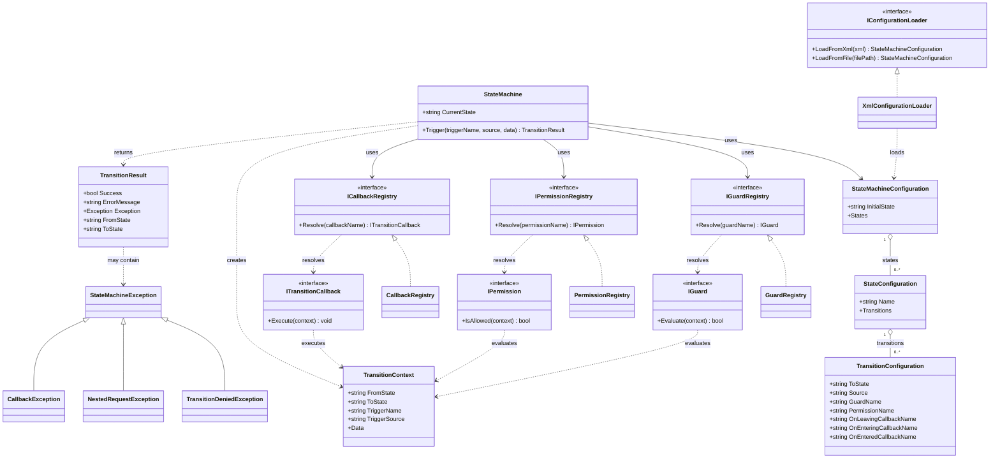

# Framework Architecture and States

## Architecture

### Core class diagram

The diagram shows the core types and their principal relationships. Names on
transitions are string references, not direct links to state or extension objects.



In the debugger, the configuration, transition context, result, and machine
types show their key values. The state configuration's transition count is the
total number of transitions across all trigger groups. A transition
configuration displays its target and each optional property that is not null.

### State Representation

Each XML `<State name="...">` defines a named state, and the machine exposes
its current state as a string. A state may optionally specify `stateClass` to
associate it with an application-supplied object derived from `State`. Both
representations use the same transition engine and can be mixed in one machine.
Existing named-only configurations require no state objects.

`State` provides virtual `CanEnter` and `CanExit` methods that default to
`true`, and `Enter` and `Exit` methods that default to no-ops. Override only
the behavior needed. State checks are intended for state-specific rules;
transition guards and permissions remain appropriate for transition-specific
conditions and authorization. This distinction is guidance, not a security
boundary enforced by the framework.

```xml
<State name="InReview" stateClass="ReviewState">
  <Transitions>
    <Transition trigger="Approve" to="Approved" />
  </Transitions>
</State>
```

```csharp
using Avak.StateMachine.Core;
using Avak.StateMachine.Core.Extensions;

public sealed class ReviewState : State
{
    public override bool CanEnter(StateContext context) => true;
    public override void Enter(StateContext context) { /* application behavior */ }
}

var states = new StateRegistry();
states.Register("ReviewState", new ReviewState());
var machine = new StateMachine(configuration, null, null, null, null, states);
```

The six-argument constructor accepts guard, permission, and callback registries,
an optional logger, and the state registry in that order. Pass the application's
registries in place of `null` when the XML names those extensions. The original
constructor remains available; it uses an empty state registry and therefore
rejects configurations that reference a state class.

The XML value is a registry key, not a CLR type name: no reflection or dynamic
type loading is performed. Every configured key must be nonblank and resolve
before initial entry, otherwise construction fails explicitly. The machine
resolves and retains each configured object at construction; later registry
changes do not replace it. The application owns the objects and their lifetime:
the framework does not create or dispose them. Use separate instances per
machine when state objects hold mutable data. Do not mutate the configuration
after construction.

For a class-backed initial state, construction calls `CanEnter` and then
`Enter`. A denied check throws `TransitionDeniedException`; a method exception
throws `StateExecutionException` with the original exception as its inner
exception. No usable machine is returned on failure, and transition callbacks
do not run for initialization. Initial entry can produce external side effects
even if construction later fails; they are not automatically undone.

State methods receive a `StateContext`: `FromState`, `ToState`, `TriggerName`,
`TriggerSource`, `Data`, and `IsInitialization`. During initialization,
`FromState`, `TriggerName`, and `TriggerSource` are null, `ToState` is the
initial state, and `Data` starts empty. For a trigger, context values describe
the transition and `Data` is the same dictionary supplied to transition
callbacks. Self-transitions invoke both source and target methods, subject to
earlier checks and methods succeeding. See [Transition Execution Flow](TransitionProcessing.md#transition-execution-flow)
for ordering and failure behavior.

State classes are available in the published `0.1.0-preview.2` package.

## Related guides

- [API reference](ApiReference.md)
- [XML configuration](XmlConfiguration.md)
- [Transition processing](TransitionProcessing.md)
- [Framework overview](Framework.md)
