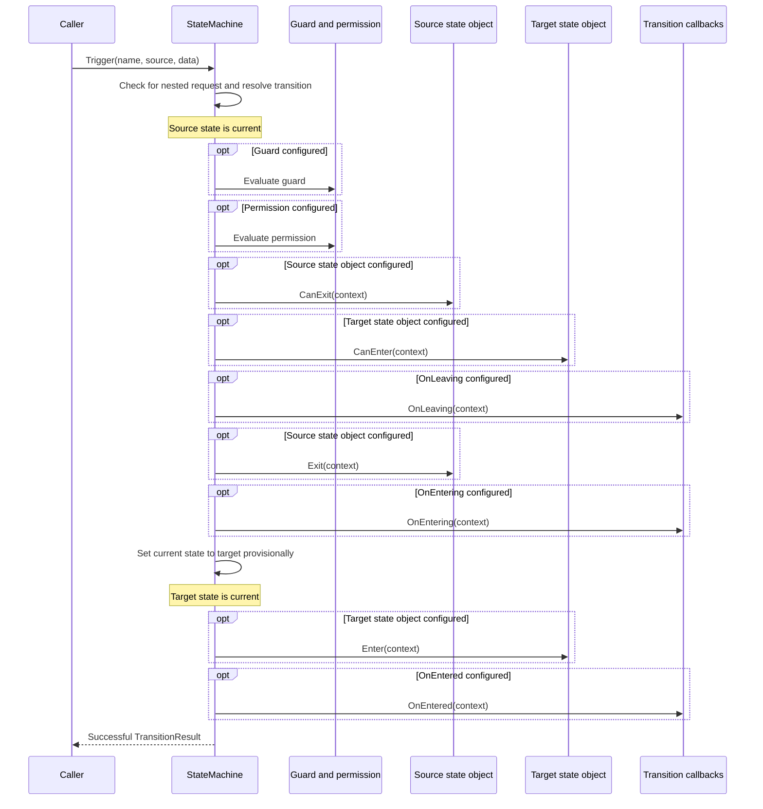

# Transition Processing

## Key Features

### 1. XML-Based Configuration
- State machines are defined in XML and validated before runtime
- DTDs and external entity resolution are prohibited for security
- Clear, readable declarative syntax for state and transition definitions

### 2. Source-Aware Triggers
- Transitions are resolved by:
  - Current state
  - Trigger name
  - Trigger source (optional, e.g., "UI", "API", etc.)
- Multiple transitions can exist for the same (state, trigger) pair if they differ by source
- Fallback to source-agnostic transitions when source-specific ones don't match

### 3. Extension Points
The framework provides three types of extension points, all injected via registries:

#### Guards
- Evaluate conditions before a transition begins
- If a guard returns `false`, the transition is denied immediately
- State machine remains unchanged; no callbacks are executed

#### Permissions
- Evaluate authorization/policy before a transition begins
- Similar to guards but semantically represent "does the caller have permission?"
- If a permission returns `false`, the transition is denied

#### Resolving configured names
Guard, permission, and callback names are optional, but every non-null name in the
configuration must resolve through its corresponding registry when the
`StateMachine` is constructed. Register implementations before construction.
An unresolved name throws `UnresolvedExtensionException` with the extension
type, name, state, and trigger; a present but blank name is invalid. If no
registry is supplied, the framework uses an empty registry, so construction
succeeds only when the configuration does not reference names in that registry.

Registries are consulted again when a transition runs. If a custom registry
later stops resolving a previously registered name, the transition fails
explicitly; missing guards and permissions never allow a transition, and
missing callbacks are never silently skipped.

#### Lifecycle Callbacks
Callbacks are named on individual transitions. With named-only states, they run
in this order:

1. **OnLeaving**: work associated with leaving the source state, such as releasing resources.
2. **OnEntering**: work associated with preparing the target state, such as initializing resources.
3. The machine changes `CurrentState` to the target state.
4. **OnEntered**: work associated with having entered the target state, such as notifying observers.

Both `OnLeaving` and `OnEntering` run while the source state is current; they
separate responsibilities rather than observe different current states.
`OnEntered` runs while the target state is current, but the transition is
provisional until the callback returns successfully. There is currently no
`OnLeft` callback.

If a callback throws, the transition fails and the machine restores its internal
source state. External side effects from callbacks are not automatically undone;
avoid irreversible work or provide application-level compensation.

A request made while the same machine is processing another request is rejected
with a failed result containing `NestedRequestException`. The outer transition
also fails and restores its source state even if the nested result is ignored or
its exception is caught. This applies to guards, permissions, and callbacks.
No later transition stages run after the nested attempt is detected. If a
callback itself throws, its failure is reported as a `CallbackException`.

### 4. Explicit Failure Handling
Each transition returns a `TransitionResult` containing:
- `Success`: Boolean indicating whether the transition succeeded
- `ErrorMessage`: Detailed error message (if failed)
- `Exception`: The underlying exception (if applicable)
- `FromState` and `ToState`: Source and target states

Failure modes include:
- **Guard denied**: Guard returned `false`
- **Permission denied**: Permission returned `false`
- **Callback threw**: Lifecycle callback raised an exception
- **Nested request**: A trigger was attempted while another transition was in progress
- **Invalid trigger**: No transition exists for the given (state, trigger, source) combination

### 5. Automatic Rollback
When a transition fails:
- The machine's internal `CurrentState` is restored to the source state
- No callbacks are executed after the failure point
- External side effects performed by earlier callbacks are NOT automatically undone

### 6. Single-Threaded, Synchronous Design
- The framework is designed for single-threaded, synchronous use
- Nested requests (triggers fired while another request is processing) are rejected
- No concurrency guarantees in this version
## Transition Execution Flow

When `machine.Trigger("TriggerName", "SourceValue", data)` is called:

1. **Nested Request Check**: If the machine is already processing a transition, return failure with `NestedRequestException`; the outer request also fails and restores its source state
2. **Trigger Resolution**: Look up transitions in `CurrentState` for matching trigger name
3. **Transition Selection**: 
   - Prefer source-specific transitions if a matching source exists
   - Fall back to source-agnostic transitions (where `source` is `null`)
   - If no match found, return failure
4. **Guard Evaluation**: If guard exists, invoke it
   - If guard returns `false`, return failure with `TransitionDeniedException`
   - If guard throws, return failure with the exception
5. **Permission Evaluation**: If permission exists, invoke it
   - If permission returns `false`, return failure with `TransitionDeniedException`
   - If permission throws, return failure with the exception
6. **State checks**: Call the source object's `CanExit`, then the target
   object's `CanEnter`, when configured. A `false` result returns a
   `TransitionDeniedException`; an exception returns `StateExecutionException`
   with the original exception as its inner exception.
7. **Leaving**: Invoke `OnLeaving`, then source `Exit`, while the source is current.
8. **Entering**: Invoke `OnEntering`, while the source is still current.
9. **Transition**: Update `CurrentState` to the target provisionally.
10. **Entry**: Invoke target `Enter`, then `OnEntered`, while the target is current.
11. **Success**: Return `TransitionResult` with `Success = true`.

The following diagram shows the successful path. Optional stages run only when
their guard, permission, callback, or state object is configured.

An unmatched trigger, denial, exception, or nested request stops the successful
path. For a failed transition, the machine restores its internal source state
and returns a failure result; external side effects are not undone. Exceptions
that escape trigger processing, such as a throwing logger, propagate instead.

Each stage runs only if earlier stages succeeded. On a state method or callback
exception, the machine restores its internal source state and returns a failed
result. A nested request inside a state method is rejected and causes the outer
request to fail even if ignored or caught. If that method also throws, its
failure is reported as `StateExecutionException`.

## Related guides

- [XML configuration](XmlConfiguration.md)
- [API reference](ApiReference.md)
- [Failure handling and rollback](FailureHandling.md)
- [Framework overview](Framework.md)
