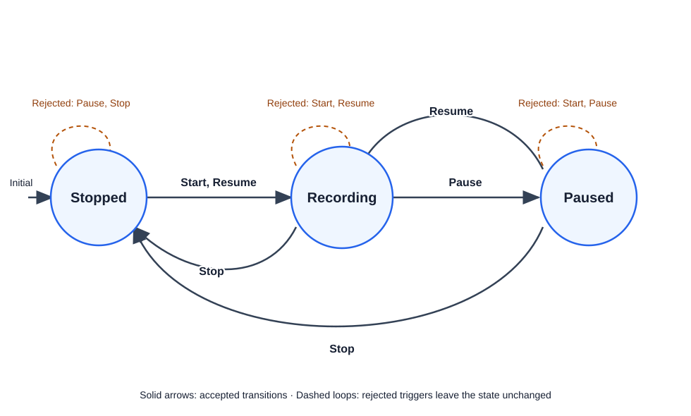

# Recorder Sample

## Overview

The **Recorder Sample** demonstrates a simple audio recorder state machine using the AvakStateMachine framework. It showcases all key features:
- XML configuration for state machine definition
- Source-aware triggers (if extended)
- Named guards for business logic
- Lifecycle callbacks for state management
- Failure handling and validation

This sample is minimal but complete—it defines the essential states and transitions for a recorder, making it easy to understand and extend.

## State Diagram



## States

### `Stopped`
The initial state. The recorder is idle and not capturing audio.

**Transitions:**
- **`Start`** → `Recording`: Begin recording
- **`Resume`** → `Recording`: Resume from paused (treat as fresh start)

### `Recording`
The recorder is actively capturing audio.

**Transitions:**
- **`Pause`** → `Paused`: Temporarily pause recording without stopping
- **`Stop`** → `Stopped`: Stop recording and finalize

### `Paused`
Recording was paused. The buffer is retained but no new audio is captured.

**Transitions:**
- **`Resume`** → `Recording`: Continue recording where it paused
- **`Stop`** → `Stopped`: Stop and finalize

## Configuration

The recorder uses the following XML configuration (`RecorderConfiguration.xml`):

```xml
<?xml version="1.0" encoding="utf-8"?>
<StateMachine initialState="Stopped">
  <States>
    <State name="Stopped">
      <Transitions>
        <Transition trigger="Start" to="Recording" 
          onLeaving="PrepareRecording" 
          onEntered="OnRecordingStarted" />
        <Transition trigger="Resume" to="Recording" />
      </Transitions>
    </State>
    <State name="Recording">
      <Transitions>
        <Transition trigger="Pause" to="Paused" 
          onLeaving="OnRecordingPaused" />
        <Transition trigger="Stop" to="Stopped" 
          onLeaving="OnRecordingStopped" />
      </Transitions>
    </State>
    <State name="Paused">
      <Transitions>
        <Transition trigger="Resume" to="Recording" 
          onLeaving="OnResumeRecording" 
          onEntering="ValidateResumeState" />
        <Transition trigger="Stop" to="Stopped" 
          onLeaving="OnRecordingStopped" />
      </Transitions>
    </State>
  </States>
</StateMachine>
```

## Implementation

### `RecorderStateMachine` Class

Wrapper class that:
1. Loads the XML configuration
2. Instantiates guard, permission, and callback registries
3. Creates and returns a `StateMachine` instance

```csharp
public class RecorderStateMachine
{
    public StateMachine Machine { get; }
    
    public RecorderStateMachine()
    {
        var loader = new XmlConfigurationLoader();
        var config = loader.LoadFromFile(GetConfigFilePath());
        
        var guardRegistry = new GuardRegistry();
        guardRegistry.Register("CheckAudioDeviceAvailable", new AudioDeviceAvailableGuard());
        
        var permissionRegistry = new PermissionRegistry();
        permissionRegistry.Register("AdminOnly", new AdminOnlyPermission());
        
        var callbackRegistry = new CallbackRegistry();
        // Register callbacks...
        
        Machine = new StateMachine(config, guardRegistry, permissionRegistry, callbackRegistry);
    }
    
    public TransitionResult Start() => Machine.Trigger("Start");
    public TransitionResult Pause() => Machine.Trigger("Pause");
    public TransitionResult Resume() => Machine.Trigger("Resume");
    public TransitionResult Stop() => Machine.Trigger("Stop");
}
```

### Guards and Permissions

Placeholder implementations provided for extension:

```csharp
public class AudioDeviceAvailableGuard : IGuard
{
    public bool Evaluate(TransitionContext context)
    {
        // In a real implementation, check if audio device is available
        return true;
    }
}

public class AdminOnlyPermission : IPermission
{
    public bool IsAllowed(TransitionContext context)
    {
        // In a real implementation, verify caller has admin rights
        return true;
    }
}
```

### Callbacks

Placeholder implementations provided for extension:

```csharp
public class PrepareRecordingCallback : ITransitionCallback
{
    public void Execute(TransitionContext context)
    {
        // Initialize recording buffer, open audio file, etc.
    }
}

public class OnRecordingStartedCallback : ITransitionCallback
{
    public void Execute(TransitionContext context)
    {
        // Log transition, update UI, notify listeners
    }
}

// Other callbacks follow similar pattern...
```

## Usage Examples

### Basic Usage
```csharp
var recorder = new RecorderStateMachine();

// Start recording
var result = recorder.Start();
if (result.Success)
{
    Console.WriteLine($"Recording started. State: {recorder.Machine.CurrentState}");
}

// Pause recording
result = recorder.Pause();
if (result.Success)
{
    Console.WriteLine("Recording paused.");
}

// Resume recording
result = recorder.Resume();
if (result.Success)
{
    Console.WriteLine("Recording resumed.");
}

// Stop recording
result = recorder.Stop();
if (result.Success)
{
    Console.WriteLine("Recording stopped.");
}
```

### Error Handling
```csharp
var recorder = new RecorderStateMachine();

// Try to pause without starting first
var result = recorder.Pause();
if (!result.Success)
{
    Console.WriteLine($"Error: {result.ErrorMessage}");
    // Expected: "No transition configured for trigger 'Pause' from state 'Stopped'"
}

// Machine state remains unchanged
Console.WriteLine($"State: {recorder.Machine.CurrentState}"); // Still "Stopped"
```

### Extending with Custom Logic

To add actual recording logic:

1. **Update Guards** to check real device state
2. **Update Permissions** to verify user authorization
3. **Update Callbacks** to perform actual recording operations

Example extension:
```csharp
public class RealAudioDeviceGuard : IGuard
{
    private readonly IAudioDevice _device;
    
    public RealAudioDeviceGuard(IAudioDevice device) => _device = device;
    
    public bool Evaluate(TransitionContext context)
    {
        return _device.IsReady;
    }
}

public class StartRecordingCallback : ITransitionCallback
{
    private readonly IAudioRecorder _recorder;
    
    public void Execute(TransitionContext context)
    {
        _recorder.Initialize();
        _recorder.BeginCapture();
    }
}
```

## Test Coverage

The sample tests (`RecorderStateMachineTests`) verify:

| Test | Scenario |
|------|----------|
| `RecorderInitializesInStoppedState` | Recorder starts in `Stopped` state |
| `Start_FromStopped_TransitionsToRecording` | `Start` trigger transitions to `Recording` |
| `Pause_FromRecording_TransitionsToPaused` | `Pause` trigger transitions to `Paused` |
| `Resume_FromPaused_TransitionsToRecording` | `Resume` from `Paused` goes to `Recording` |
| `Stop_FromRecording_TransitionsToStopped` | `Stop` from `Recording` goes to `Stopped` |
| `Stop_FromPaused_TransitionsToStopped` | `Stop` from `Paused` goes to `Stopped` |
| `Resume_FromStopped_TransitionsToRecording` | `Resume` from `Stopped` goes to `Recording` |
| `Pause_FromStopped_FailsAndPreservesState` | Invalid `Pause` remains in `Stopped` |
| `Stop_FromStopped_FailsAndPreservesState` | Invalid `Stop` remains in `Stopped` |
| `Start_FromRecording_FailsAndPreservesState` | Invalid second `Start` remains in `Recording` |

All tests are deterministic and have no external dependencies.

## Extension Ideas

### 1. Add Specific Permission Requirements
```xml
<Transition trigger="Start" to="Recording" permission="RecorderOperator" ... />
```

Implement `RecorderOperatorPermission` to check user roles.

### 2. Add Quality Validation Guard
```xml
<Transition trigger="Start" to="Recording" guard="AudioQualityCheck" ... />
```

Implement `AudioQualityCheckGuard` to verify audio input levels.

### 3. Enhanced Callbacks with Logging
Enhance each callback to log state transitions and prepare resources:
- `PrepareRecordingCallback`: Initialize buffers, check disk space
- `OnRecordingStartedCallback`: Log start time, notify UI
- `OnRecordingPausedCallback`: Flush buffers, update metadata
- `OnRecordingStopped`: Finalize file, compute duration

### 4. Support Recording Parameters
Pass parameters via `TransitionContext.Data`:
```csharp
var result = recorder.Machine.Trigger("Start", data: new Dictionary<string, object?>
{
    ["quality"] = "high",
    ["format"] = "WAV"
});
```

### 5. Source-Aware Transitions
Distinguish between UI-initiated and API-initiated recordings:
```xml
<Transition trigger="Start" source="UI" to="Recording" ... />
<Transition trigger="Start" source="API" to="Recording" ... />
```

## Running Tests

```bash
cd src/Samples
dotnet test Avak.StateMachine.Samples.slnx --logger:console
```

Expected output:
```
Passed!  - Failed: 0, Passed: 10, Skipped: 0, Total: 10, Duration: ~100ms
```

## Key Learnings

The Recorder Sample demonstrates:

1. **Complete Configuration**: All elements (states, transitions, guards, permissions, callbacks) in one place
2. **Clean Separation**: Application logic (guards/callbacks) separate from machine definition (XML)
3. **Explicit Failure Modes**: Invalid transitions are caught cleanly
4. **Extensibility**: Guards and callbacks are easy to enhance without changing the framework
5. **Testability**: Clear state transitions make testing straightforward

This sample serves as a template for other domain-specific state machines.
