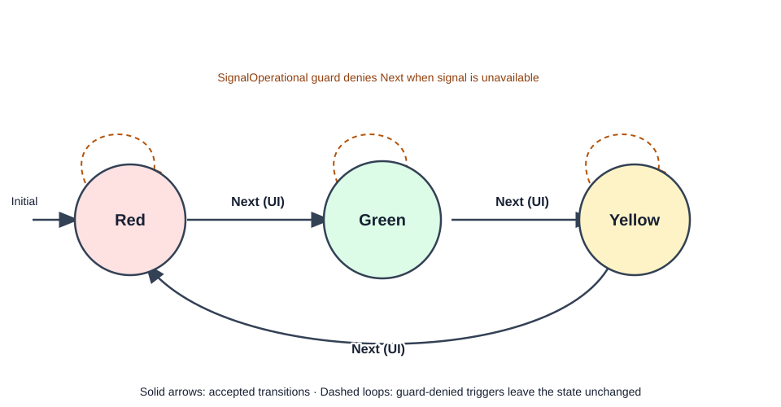

# WPF Traffic Light With Dependency Injection

This sample uses a WPF window and view model to demonstrate the traffic-light
state machine with `Microsoft.Extensions.DependencyInjection`. The core
framework remains independent of the DI container.

## State graph



## How it works

- XML configures `Red` → `Green` → `Yellow` → `Red` using the UI-sourced
  `Next` trigger.
- `App` loads the XML, builds a validated service provider, creates a scope,
  resolves the main window from that scope, and disposes the scope and provider
  when the application exits.
- The state machine, view model, session data, guard, and callback are scoped.
  The guard and callback use the same `TrafficLightSession` as the view model.
- The **Signal is operational** checkbox controls the injected
  `SignalOperationalGuard`. When unchecked, `Next` is denied and the light
  remains in its current state.
- The `RecordTransitionCallback` records each accepted state change in the
  scoped session, and the view model displays the most recent transition.

An application concept (one traffic-light session) is represented by a DI
scope in this sample. The scope provides shared scoped instances; it does not
make the state machine thread-safe, and the machine remains single-threaded.

## Run and test

From the repository root on Windows with the .NET Windows Desktop runtime:

```shell
dotnet run --project src/Samples/201500_WpfTrafficLightWithDI/WpfTrafficLightWithDI/WpfTrafficLightWithDI.csproj
dotnet test src/Samples/201500_WpfTrafficLightWithDI/WpfTrafficLightWithDI.slnx
```

The view-model tests exercise the light cycle, guard denial, and scope isolation
without opening a WPF window.
