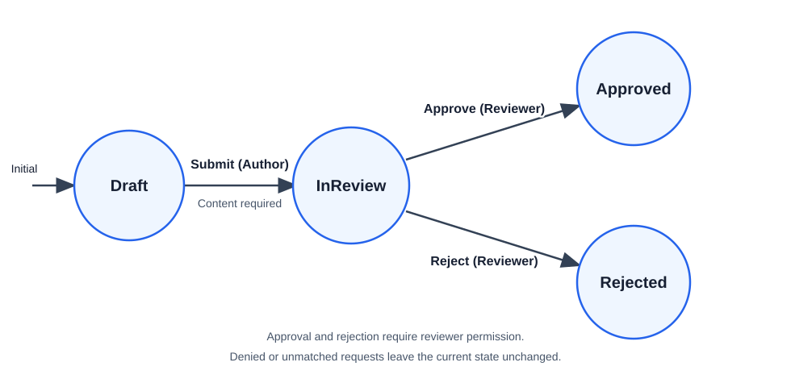

# Console Document Workflow

This sample demonstrates framework-managed C# state classes in a small,
XML-configured document approval workflow. Each workflow creates a state
machine and state objects tied to its supplied document and in-memory audit.

## Workflow



- Initial entry to `DraftState` records `Draft created`.
- `DraftState.CanExit` denies submission when the document has no content.
- `InReviewState.Enter` records submission; `ApprovedState.Enter` and
  `RejectedState.Enter` record the review decision.
- XML requires the `Author` trigger source for submission and the `Reviewer`
  source for approval or rejection. The named `ReviewerPermission` separately
  checks the role supplied in the transition data.
- The program demonstrates submission, a denied author approval, and a
  successful reviewer approval. Tests also exercise rejection and failure paths.

The role is caller-supplied sample data, **not authentication**. Real
applications must obtain authorization information from a trusted source;
neither a trigger source nor this example permission proves a user's identity.
Audit entries are in memory for illustration, not durable audit records. The
framework restores its internal state on failure but cannot undo changes made
by state objects or external side effects.

The sample uses a project reference to the framework so it exercises the source
in this repository. State classes are also available in the published
`0.1.0-preview.2` package. The application supplies the document and owns its
lifetime; use a separate document per independent workflow. Each machine must
be used single-threadedly.

## Run and test

From the repository root:

```shell
dotnet run --project src/Samples/201900_ConsoleDocumentWorkflow/ConsoleDocumentWorkflow/ConsoleDocumentWorkflow.csproj
dotnet test src/Samples/201900_ConsoleDocumentWorkflow/ConsoleDocumentWorkflow.slnx
```
