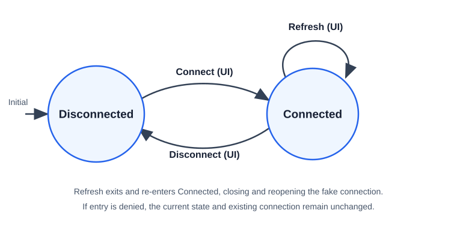

# Windows Forms Self-Transition: Network Connection

This Windows Forms sample illustrates a self-transition using a simulated
network connection. No real network, device, timer, or external service is used.

## State graph



The machine starts in `Disconnected`. **Connect** transitions to `Connected`;
**Disconnect** returns to `Disconnected`. **Refresh** is a self-transition
from `Connected` back to `Connected`: the state name stays the same, but the
state object's exit and entry behavior still runs.

## Try it

1. Select **Connect** to open the fake connection.
2. Select **Refresh**. The event list shows `CanExit`, `CanEnter`, `Exit`,
   closing the connection, `Enter`, and reopening it, in that order.
3. Clear **Connection available** and select **Refresh** again. `CanEnter`
   denies the transition before `Exit`; the existing connection remains open.
4. Select **Disconnect** to close the fake connection.
5. Select **Clear events** to empty the event list without changing the state
   or the connection. Later transitions add new events.

`Disconnected` is a named-only state; `ConnectedState` is a registered C#
state object. The event list records the check calls for demonstration: real
state checks should avoid side effects. The checkbox changes a property of the
in-memory fake, not an actual network connection.

If a later action throws after exit has already closed a connection, the
framework restores only its internal state; it cannot reopen the connection
or undo other external side effects. Applications must arrange compensation
or recovery when needed. The sample uses a framework project reference; state
classes are included starting with `0.1.0-preview.2` once that package is published.

## Run and test

From the repository root on Windows with the .NET Windows Desktop runtime:

```shell
dotnet run --project src/Samples/202400_WinFormsSelfTransitionNetworkConnection/WinFormsSelfTransitionNetworkConnection/WinFormsSelfTransitionNetworkConnection.csproj
dotnet test src/Samples/202400_WinFormsSelfTransitionNetworkConnection/WinFormsSelfTransitionNetworkConnection.slnx
```

Tests exercise the workflow and fake connection without opening the form.
